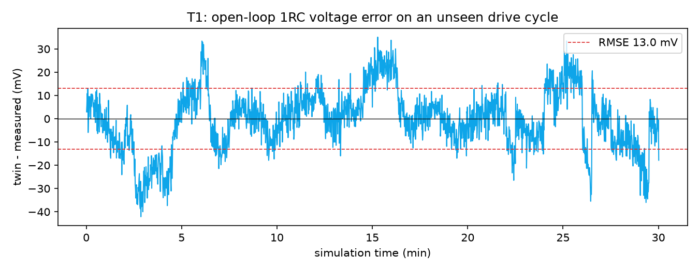
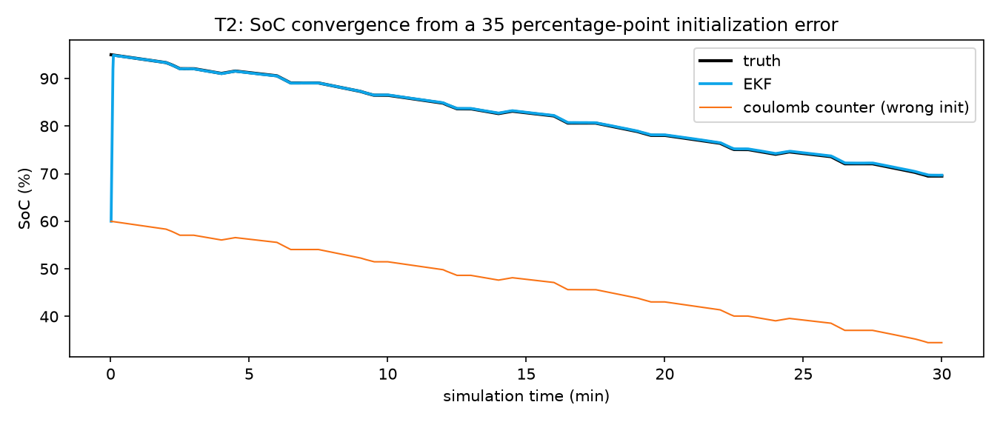
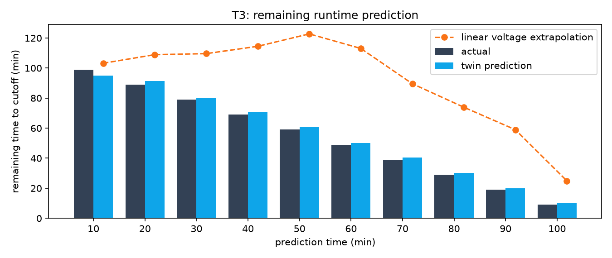
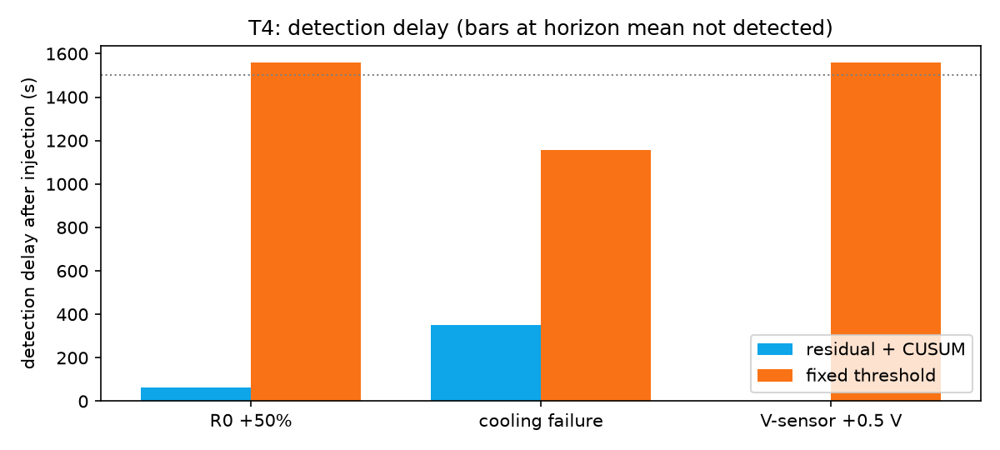
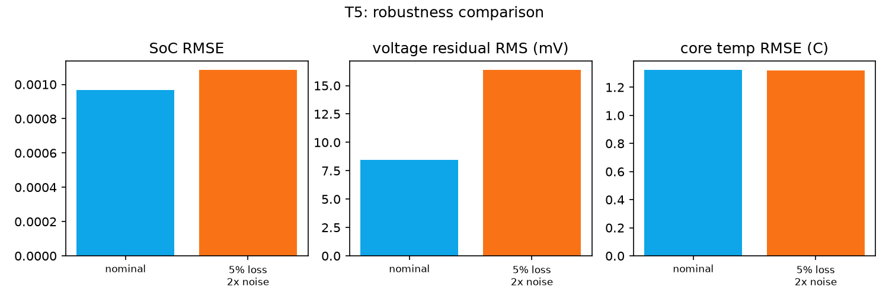

# 评估结果

生成时间：2026-11-18T04:00:55.802Z

Plant 使用 2RC + 双节点热模型 + Arrhenius 内阻 + 老化漂移；Twin 使用离线辨识的 1RC + 单节点热模型 + EKF + RLS。所有 twin 更新只使用 telemetry；truth 与 plant 参数仅在评估时用于打分。

## 参数辨识（HPPC，仅用测量列）

- 辨识结果：R0 = 0.10398 Ω，R1 = 0.05555 Ω，C1 = 1248.4 F，Cth = 3204 J/K，hA = 4.03 W/K
- 辨识集电压拟合：RMSE 8.81 mV，最大误差 29.52 mV

## T1 模型精度：未参与辨识的工况

| 指标 | 数值 |
|---|---:|
| 1RC 端电压 RMSE | 13.04 mV |
| 1RC 最大绝对误差 | 42.13 mV |
| 无 RC 松弛项的 RMSE（对照） | 285.85 mV |



## T2 SoC 估计：初值故意错 35 个百分点

| 指标 | EKF | 纯库仑计数 |
|---|---:|---:|
| 收敛到 ±2% 的时间 | 6 s | 不收敛 |
| 收敛后 RMSE | 0.11% | 35.00% |
| 最大误差（t>30 s） | 0.23% | — |
| 末态误差 | +0.19% | — |



## T3 续航预测

- 实际到达截止电压时间：109.0 min
- Twin（10 min 平均电流外推）MAPE：**4.23%**
- 线性电压外推基线 MAPE：**104.04%**
- 检查点数：10

| 预测时刻 (min) | 实际剩余 (min) | Twin 预测 (min) | 线性外推 (min) |
|---:|---:|---:|---:|
| 10 | 99.0 | 95.1 | 103.2 |
| 20 | 89.0 | 91.4 | 108.9 |
| 30 | 79.0 | 80.2 | 109.6 |
| 40 | 69.0 | 70.8 | 114.5 |
| 50 | 59.0 | 61.0 | 122.7 |
| 60 | 49.0 | 50.1 | 113.0 |
| 70 | 39.0 | 40.5 | 89.6 |
| 80 | 29.0 | 30.2 | 73.9 |
| 90 | 19.0 | 19.8 | 59.0 |
| 100 | 9.0 | 10.2 | 24.9 |



## T4 异常检测

- 正常数据（1 h）误报：**0** 次（none）
- 正常数据上的 99.5 分位：|电压残差| 46.4 mV，|温度残差| 1.43 °C，R0 比率最大 1.043，SoC 一致性最大 0.28%
- 阈值只用正常数据确定；故障数据仅用于计算检测延迟。
- 当前配置阈值：温度残差 2.0 °C / 45.0 s，R0 比率 1.2 / 3.0 s，SoC 一致性 1.5% / 60.0 s，急性电压阶跃 0.3 V。

| 场景 | 本方法检测延迟 | 固定阈值基线 | 触发的告警 |
|---|---:|---:|---|
| R0 +50% | 63 s | 未检测 | RESISTANCE_ANOMALY |
| 冷却失效 | 352 s | 1158 s | THERMAL_ANOMALY |
| 电压传感器 +0.5V | 1 s | 未检测 | VOLTAGE_ANOMALY |



## T5 鲁棒性：5% 丢包 + 噪声加倍

| 指标 | 标称 | 退化 |
|---|---:|---:|
| SoC RMSE (%) | 0.097 | 0.108 |
| 电压残差 RMS (mV) | 8.464 | 16.374 |
| 核心温度 RMSE (°C) | 1.323 | 1.321 |
| twin 更新次数 | 1800 | 1720 |
| 检测到的包序号缺口 | 0 | 80 |

SoC RMSE 退化 +12.0%，核心温度 RMSE 退化 -0.2%。



## 局限（主动说明）

- 1RC 模型在低 SoC、低温和大倍率脉冲下的电压误差会增大；本报告只覆盖 20–35 °C。
- 没有真实电池数据；plant 与 twin 的差异是刻意构造的，但仍属于仿真验证。
- 电芯被视为完全一致，无法检测单体失衡或局部热点。
- 小电压偏置（例如 0.2 V）与 SoC 变化在短时间内不可区分；本演示使用 0.5 V 阶跃。
- 异常阈值只在一个正常工况族上标定，换工况需要重新标定。
- SQLite 适合单资产演示，不适合多车队高并发写入。

## 复现

```bash
.venv/bin/python scripts/identify_params.py --reuse-log
.venv/bin/python scripts/evaluate.py
```